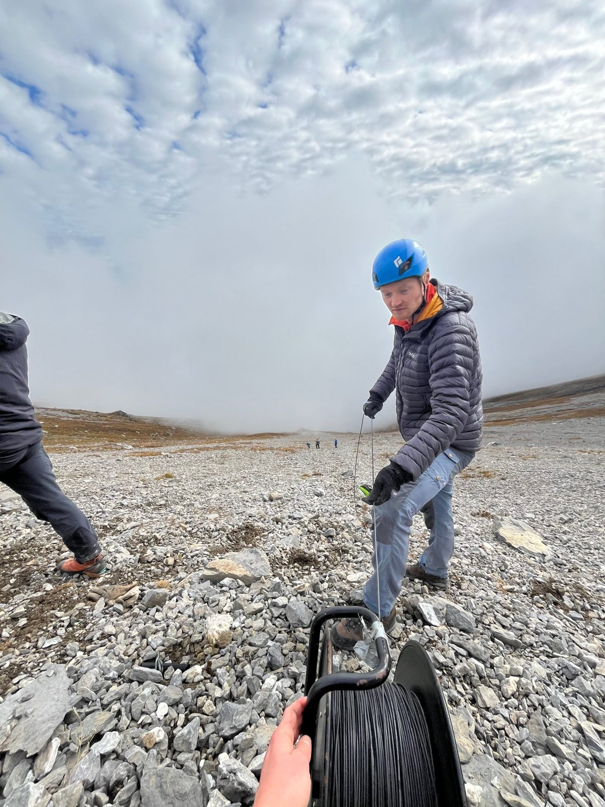
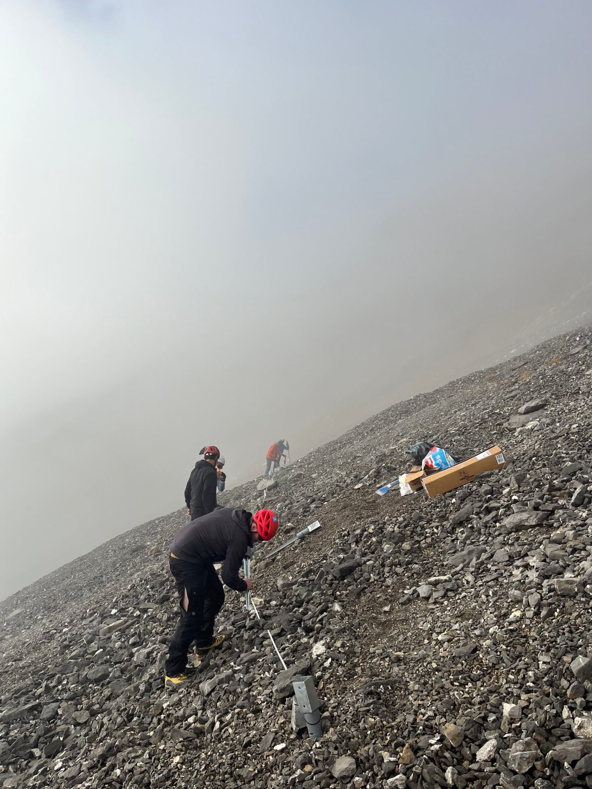

In 2024 I joined a campaign to deploy a **fibre-optic cable on an avalanche-prone slope**, turning the cable itself into a dense line of sensors. I contributed to designing the cable layout and the **anchoring system** that keeps it in place on loose, steep scree through the winter.



<figure><figcaption>Unrolling the cable across the slope.</figcaption></figure>
<figure><figcaption>Installing anchors in the fog.</figcaption></figure>

Working at altitude, in changing weather and with limited time on site, is a good lesson in designing experiments that are robust before they are optimal, which is exactly the question my research tries to formalise.


