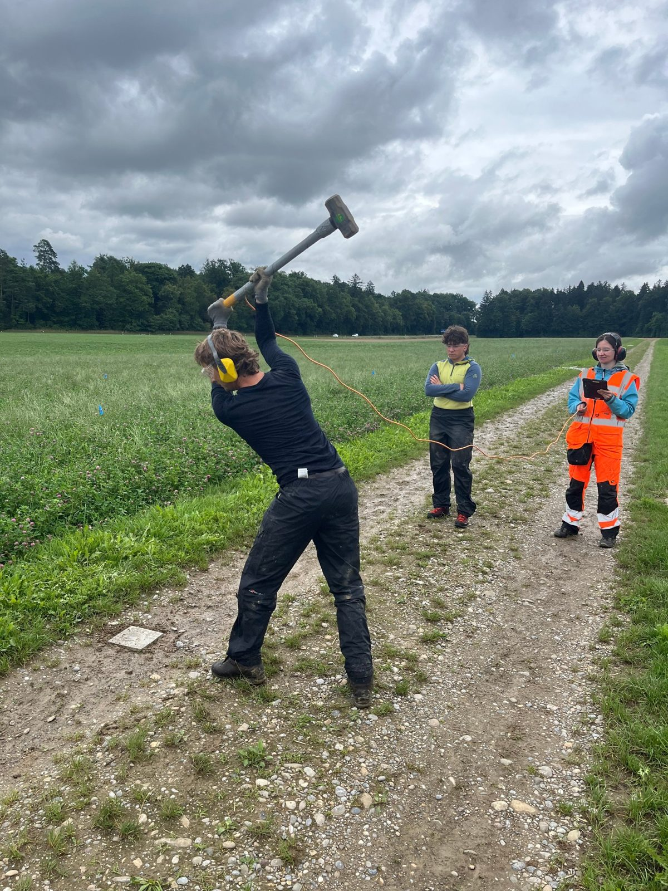
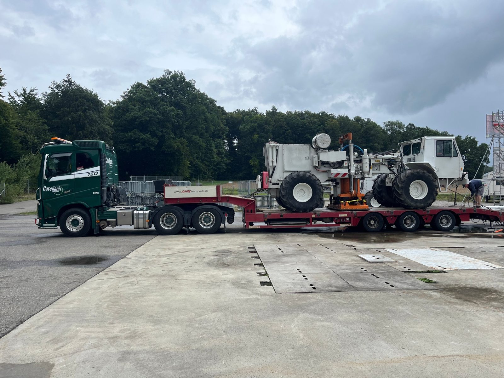

Methods developed on synthetic models have to survive real data. In 2025 I led the completion of a **near-surface 3D seismic survey** in the context of CO₂ storage monitoring: about **1,000 seismic nodes** and **150 shots**, acquired with a four-person team while coordinating with contractors for the heavy equipment.

<figure><figcaption>Sledgehammer shot along a field track.</figcaption></figure>
<figure><figcaption>The vibroseis source arriving on site.</figcaption></figure>

Every node position has to be known precisely, so a large part of the work is surveying: walking the layout with a GNSS receiver, including through fields of maize taller than the crew.



The dataset is now the testbed for the rest of my work: 3D elastic FWI with Salvus, and the [QR-based data selection](/research/qr-data-selection/) applied at field scale. With this many sources and receivers, the full sensitivity matrix is too large to assemble, so I am building an HPC workflow that selects data without ever forming it explicitly.

---

##### Read more

+ Methods: [QR-based data selection](/research/qr-data-selection/), [designing FWI problems](/research/designing-fwi/)
